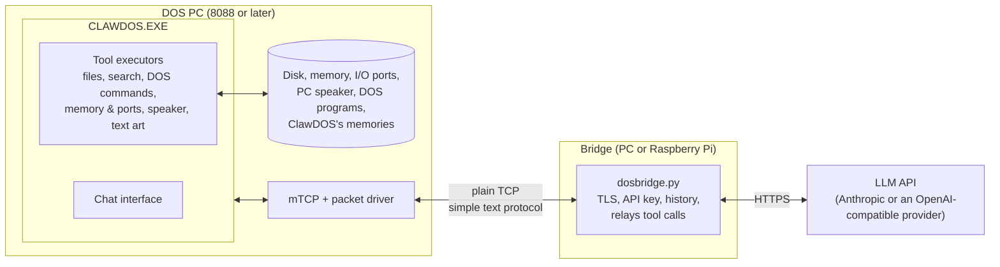

<h1 align="center">ClawDOS</h1>

<p align="center"></p>

ClawDOS is a chat and coding harness built for DOS. Built and tested to run on an
IBM PC XT (5160), but should be able to run on other similar IBM PC-compatible
machines.

## Features

ClawDOS brings a modern AI coding agent experience to vintage hardware. 

* Chat
* Tools
* Memory

## Available Tools

| Tool | What it does |
|---|---|
| `sysinfo`, `dir`, `read`, `peek` | Look at the system, directories, files (text or hex) and memory |
| `search` | Find text in files, with line numbers (much faster than running FIND) |
| `write`, `edit`, `delete`, `mkdir`, `rename` | Common filesystem operations |
| `run` | Run DOS commands read back what they printed: one per line, stopping at the first that fails |
| `poke`, `port` | Write memory, read or write I/O ports |
| `play` | Play a GW-BASIC `PLAY` tune on the PC speaker |
| `textart` | Print coloured CP437 text art into the chat |
| `memory_list`, `memory_read`, `memory_write` | ClawDOS's own notes across conversations, in `C:\MEMORY\NAME.TXT` |


## How it works

ClawDOS is a DOS program: it targets the 8086 instruction
set and talks to the network through a standard packet driver, so in principle
it runs on any PC-compatible running DOS with a network card and a CGA-compatible
text display. It was built to target a 4.77 MHz IBM PC XT (5160).

**CLAWDOS.EXE** is the harness: the AI coding agent-style interface, input handling,
tool calls, and network communication to the bridge.

The **bridge** is a shim between DOS and the LLM APIs. I didn't want to implement
the full Anthropic/OpenAI API to run on the legacy hardware - mostly to avoid the overhead of having to 

A 1980s CPU
can't do modern TLS, so the bridge holds the API key, speaks HTTPS to the
model, keeps the conversation history and relays tool calls to DOS and the
results back. 



On the real PC the network card is a PicoMEM (an emulated NE2000 that talks WiFi);
in an emulator it's an emulated NE1000/NE2000 with NAT networking. The wire
format is in [docs/PROTOCOL.md](docs/PROTOCOL.md).

## What you need

| | |
|---|---|
| **To try it** | A Mac (with Homebrew) or a Windows PC, with Python 3. Everything runs in an emulator. |
| **For real hardware** | An 8088 IBM PC (or compatible) with CGA and a PicoMEM card: it provides the disk (an image on a microSD card) and WiFi (NE2000). |
| **For the AI** | An API key (Anthropic by default), or run the bridge with `--mock` or against a local Ollama. |

## Run it locally (emulator)

1. **Fetch the tools** (once): `python3 scripts/setup-tools.py`. This downloads
   Open Watcom, FreeDOS, mTCP and more into `tools/`, and installs NASM,
   DOSBox-X and 86Box (with its ROMs) with Homebrew on a Mac or winget on
   Windows. (On Windows the commands below say `python`; on a Mac, `python3`.)
2. **Build** the disk image: `python scripts/build.py` → `build/CLAWDOS.IMG`.
3. **Start the bridge** in one terminal:
   ```
   python3 -m venv .venv
   .venv/bin/pip install -r bridge/requirements.txt
   .venv/bin/python bridge/dosbridge.py --mock
   ```
   (On Windows: `pip install -r bridge/requirements.txt` and
   `python bridge/dosbridge.py --mock`.)
   `--mock` answers like ClawDOS would, offline. For the real thing set
   `ANTHROPIC_API_KEY` (in the environment, or in a `.env` file in the repo
   root, or run `ant auth login`) and drop `--mock`.
4. **Boot an emulated 8088 PC** in another: `python scripts/run86box.py` (8088,
   640K, CGA, with an NE1000 card and NAT networking). It boots, brings up the
   network and shows the `C:\>` prompt.
5. **Type `CLAWDOS`**. In the emulator the
   bridge is the host machine, `10.0.2.2:8023`, which the image is built to use.

Prefer DOSBox-X? `python scripts/rundosbox.py` boots the same image with
networking. It is faster but less exact (it emulates an 80186).

## Run it on a real PC

1. **Build the image** with the address of the PC that will run the bridge:
   ```
   python scripts/build.py --bridge 172.16.0.100:8023
   ```
   The address is remembered. On the DOS PC it lives in `C:\NET\MTCP.CFG` as
   `CLAWDOS_BRIDGE`.
2. **Run the bridge** on that PC (or a Raspberry Pi) as above, without `--mock`
   for the real thing. The DOS PC connects in on TCP port 8023, so allow it
   through the firewall. On a Mac, accept the "allow incoming network
   connections" prompt when the bridge first starts. On Windows (admin PowerShell):
   ```
   New-NetFirewallRule -DisplayName DOSBridge -Direction Inbound -Protocol TCP -LocalPort 8023 -Action Allow
   ```
3. **Copy `CLAWDOS.IMG`** into the `HDD` folder on the PicoMEM's microSD card.
4. **Configure the PicoMEM**: in its BIOS menu pick the image as HDD0 (Disk) and
   make sure NE2000 is enabled (Other). The card's WiFi settings are its own;
   see the PicoMEM documentation.
5. **Boot the DOS PC.** Networking comes up automatically (type `NETUP` to retry),
   then type `CLAWDOS`.

### Using it

Enter sends. Esc stops a reply or clears the input. Arrows, Home, End and Del
edit; Up/Down recall earlier messages; PgUp/PgDn scroll back; F1 help, F2 new
chat, F3 safe mode, F10 quit. `CLAWDOS host:port` overrides the bridge address;
`-m text` sends a message at startup and `-i text` pre-fills the input box.
Type `/model` to list model providers and switch, and `/theme claude` or
`/theme opencode` to change colours (`CLAWDOS_THEME opencode` in `MTCP.CFG`
sets the one it starts with).

## Reference

### Tools on DOS

The bridge offers the model a fixed set of tools; CLAWDOS.EXE runs them and
shows each call in the transcript (`● Read(C:\AUTOEXEC.BAT)` / `└ 24 lines`):


**Safe mode** (on at startup, F3 toggles it, shown in the bottom row): tools
that change files, memory or ports ask `Allow ...? (y/n)` first; looking,
playing music and memories never ask. `-unsafe` starts with it off, and `-q`
quits once the `-m` message is answered (both for unattended tests). Esc
during a tool stops the reply. Programs started by `run` can't use the network
or be stopped with Ctrl-C. They get about 290K of memory: `run` starts a plain program directly, and only loads a second COMMAND.COM (about 70K) for batch files, redirection and built-in commands.

With the mock bridge, `!tool NAME key=value ...` calls any tool (e.g.
`!tool read path=C:\AUTOEXEC.BAT`), `!play` is a demo, and
`!tooltour` exercises every tool.

### Programming on the DOS PC

The image carries development tools that were tested on an 8088 at 4.77 MHz
(`python scripts/test8088.py image/tests/devtools.bat` re-runs that test in 86Box):

| Tool | What | Hello world |
|---|---|---|
| `TINYASM` | NASM-syntax assembler, makes .COM files (BSD) | ~5 s |
| `WASM` | Wolfware assembler, MASM-like (MIT) | ~5 s |
| `JWASMR` | JWasm, full MASM syntax, .COM or .EXE (Open Watcom licence) | ~18 s |
| `TCC` | Turbo C 2.0, from your own disks (see below) | ~27 s |
| `BCC` | Bruce's C, K&R C to .COM (GPL); lowercase file names only | ~80 s |
| `GWBASIC` | GW-BASIC built from Microsoft's MIT-licensed source | ~6 s |
| `LDEBUG` | lDebug, a scriptable FreeDOS DEBUG (Fair License) | |

They live in `C:\DEVEL` (licences in `C:\DEVEL\DOC`) and `C:\TC`, and
`C:\MEMORY\DEVTOOLS.TXT`, ClawDOS's first memory, tells it how to use them.
Examples are in `C:\TESTS\DEV`. Turbo C is commercial: the build copies it from
your own floppy images in `external/` (e.g. `Borland - Turbo C v2.0 - Disk 3 of
6 - Command Line and Utilities.img`) and leaves it out if they aren't there.
Pacific C was tried and hangs on an 8088. `docs/research/` has the survey of
what else runs on a DOS PC and what a licensed copy would add.

### Memories

ClawDOS keeps notes on the DOS PC itself, in `C:\MEMORY\NAME.TXT` (first line: a
one-line summary; at most 4000 bytes each). At the start of every conversation
the bridge runs `memory_list` on the DOS PC (you'll see a `Memories` line) and puts
the list into the system prompt, so ClawDOS knows what it saved before and reads
a memory in full when it's relevant. The memory tools never ask in safe mode.
Delete a memory with `DEL C:\MEMORY\NAME.TXT`, or ask ClawDOS to (that uses
`delete`, which does ask). The mock and replay backends don't list memories.

### Other models

The bridge isn't tied to Claude. Besides Anthropic's API it speaks the
OpenAI-compatible chat API that OpenRouter, Z.ai, OpenAI, Ollama, LM Studio and
most others offer, so nothing changes on the DOS PC. Built-in providers:
`anthropic` (default), `openrouter`, `zai`, `openai`, `ollama`, `mock`
(keys in `ANTHROPIC_API_KEY`, `OPENROUTER_API_KEY`, `ZAI_API_KEY`, `OPENAI_API_KEY`).
`--provider NAME --model MODEL` picks where new chats start. On the DOS PC, type
`/model` to list providers and `/model openrouter:z-ai/glm-4.6` (or
`/model zai`, or just `/model some-model` on the current provider) to switch
mid-conversation; the history carries over. To add or change providers, copy
`bridge/providers.example.toml` to `bridge/providers.toml` (format in
`bridge/providers.py`). API keys only ever come from environment variables.

### System prompts

The system prompt comes from a file: `bridge/prompts/NAME.txt`, chosen with
`--prompt NAME` (default: `default.txt`). The bridge appends its add-ons after
it: how the DOS PC's tools work, and the index of the DOS PC's memories. Since
the file is the whole prompt, it must tell the model about the screen (plain
text, 80 columns, no Markdown): copy `default.txt` to start a new one. `{name}`
becomes the assistant's name. Files are re-read at the start of every
conversation, so an edit applies from the next chat (F2 on the DOS PC) without
restarting the bridge.

### Logs

The bridge keeps two logs, both gitignored:

- `bridge/dosbridge.log`: a debug log with every protocol line (rotating; `--log FILE`).
- `bridge/logs/YYYY-MM-DD/*.jsonl`: one file per DOS PC connection, one JSON event per
  line: what you asked, Claude's replies, tool calls and results, and each API
  call's model, stop reason and token usage (`--convlog DIR`, `-` for none). Load
  it with `jq`, pandas or a few lines of Python.

## Project layout

| Path | What |
|---|---|
| `src/clawdos/` | CLAWDOS.EXE |
| `lib/` | Reusable DOS pieces: `screen` (snow-free CGA, hardware scrolling, pinned footer), `console` (word-wrapping text stream with margins), `dosbridge` (bridge protocol on mTCP), and the tool executors: `toolapi`, `dosfs`, `memory`, `sysinfo`, `shell`, `edit`, `search`, `ems`, `play` + `sound` (music) |
| `tests/unit/` | DOSUNIT.EXE: unit tests for the hardware-free parsers, run in DOSBox-X |
| `bridge/` | DOS Bridge server and a test client (`chat.py`) |
| `src/boot/` | MBR and FreeDOS boot sector |
| `image/` | What goes on the disk image (`manifest.txt`, CONFIG/AUTOEXEC, tests) |
| `scripts/` | Build, image tool (`fatimg.py`), boot test, 86Box helpers, clangd shims for the Watcom dialect (`clangd/`) |
| `docs/` | [Roadmap](docs/ROADMAP.md), [bridge protocol](docs/PROTOCOL.md), research and design notes |

## License

Programs linking mTCP (CLAWDOS.EXE, anything using `lib/dosbridge`) are GPLv3.
