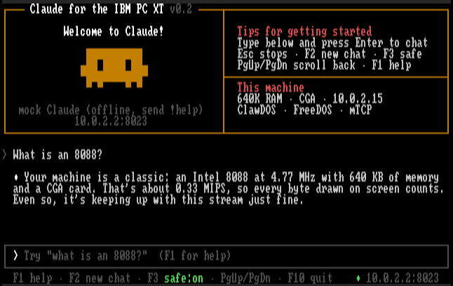
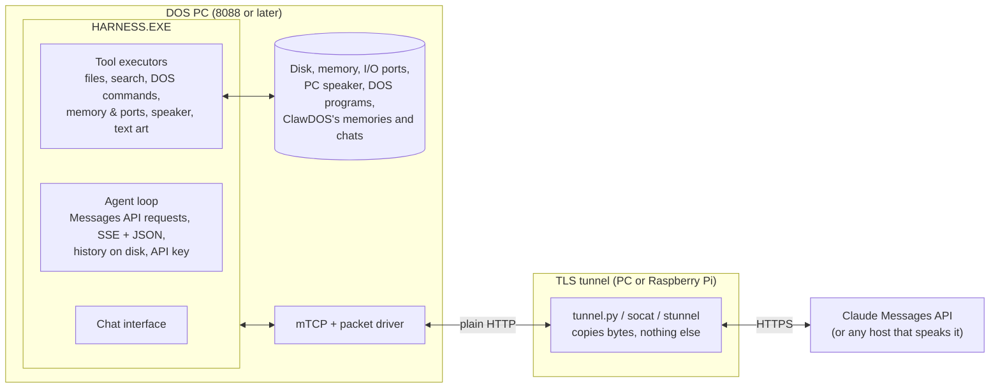

<h1 align="center">ClawDOS</h1>

<p align="center"></p>

ClawDOS is a chat and coding harness built for DOS. Built and tested to run on an
IBM PC XT (5160), but should be able to run on other similar IBM PC-compatible
machines.

## Features

ClawDOS brings a modern AI coding agent experience to vintage hardware. 

* Chat
* Tools
* Memory and skills

## Available Tools

| Tool | What it does |
|---|---|
| `sysinfo`, `dir`, `read`, `peek` | Look at the system, directories, files (text or hex) and memory |
| `search` | Find text in files, with line numbers (much faster than running FIND) |
| `write`, `edit`, `delete`, `mkdir`, `rename` | Common filesystem operations |
| `run` | Run DOS commands read back what they printed: one per line, stopping at the first that fails |
| `poke`, `port` | Write memory, read or write I/O ports |
| `play` | Play a GW-BASIC `PLAY` tune on the PC speaker |
| `textart` | Print coloured CP437 text art into the chat |
| `memory_list`, `memory_read`, `memory_write` | ClawDOS's own notes across conversations, in `C:\MEMORY\NAME.TXT` |


## How it works

ClawDOS is a DOS program: it targets the 8086 instruction
set and talks to the network through a standard packet driver, so in principle
it runs on any PC-compatible running DOS with a network card and a CGA-compatible
text display. It was built to target a 4.77 MHz IBM PC XT (5160).

**HARNESS.EXE** is the whole harness, and it runs on the 8088: it speaks the
Claude Messages API itself (request bodies, the streamed JSON reply, the tool
loop), keeps the conversation history on its own disk, holds the API key and
runs the tools.

The one thing a 1980s CPU can't do is TLS, so the only piece off the PC is a
**dumb tunnel**: a program that accepts a plain TCP connection and copies the
bytes into an HTTPS connection to `api.anthropic.com`. It knows nothing about
the API. `tunnel/tunnel.py` is 100 lines of standard-library Python; `socat` or
`stunnel` do the same job.



On the real PC the network card is a PicoMEM (an emulated NE2000 that talks WiFi);
in an emulator it's an emulated NE1000/NE2000 with NAT networking. What CLAWDOS
sends and expects is in [docs/API.md](docs/API.md).

## What you need

| | |
|---|---|
| **To try it** | A Mac (with Homebrew) or a Windows PC, with Python 3. Everything runs in an emulator. |
| **For real hardware** | An 8088 IBM PC (or compatible) with CGA and a PicoMEM card: it provides the disk (an image on a microSD card) and WiFi (NE2000). |
| **For the AI** | An Anthropic API key, or the offline mock API for a look around. Use a dedicated key with a spending limit: unless the tunnel holds it (below), it sits on the DOS PC's disk and crosses your LAN in clear on its way to the tunnel. |

## Run it locally (emulator)

1. **Fetch the tools** (once): `python3 scripts/setup-tools.py`. This downloads
   Open Watcom, FreeDOS, mTCP and more into `tools/`, and installs NASM,
   DOSBox-X and 86Box (with its ROMs) with Homebrew on a Mac or winget on
   Windows. (On Windows the commands below say `python`; on a Mac, `python3`.)
2. **Build** the disk image: `python scripts/build.py` → `build/CLAWDOS.IMG`.
3. **Start the TLS tunnel** in one terminal: `python3 tunnel/tunnel.py`. It
   listens on port 8443 and forwards to `api.anthropic.com:443`. Put your key in
   a `.env` file in the repo root (`ANTHROPIC_API_KEY=sk-ant-...`) before the
   build: it goes onto the image in `C:\CLAWDOS\CLAWDOS.CFG`.
   No key? `python3 tunnel/mockapi.py` fakes the API offline on port 18023
   (then type `CLAWDOS 10.0.2.2:18023` on the DOS PC and send `!help`).
4. **Boot an emulated 8088 PC** in another: `python scripts/run86box.py` (8088,
   640K, CGA, with an NE1000 card and NAT networking). It boots, brings up the
   network and shows the `C:\>` prompt.
5. **Type `CLAWDOS`** (see [Memory for programs](#memory-for-programs)).
   In the emulator the tunnel is the host machine, `10.0.2.2:8443`, which the
   image is built to use.

Prefer DOSBox-X? `python scripts/rundosbox.py` boots the same image with
networking. It is faster but less exact (it emulates an 80186).

## Run it on a real PC

1. **Build the image** with the address of the PC that will run the tunnel:
   ```
   python scripts/build.py --tunnel 172.16.0.100:8443
   ```
   The address is remembered. On the DOS PC it is the `tunnel` line of
   `C:\CLAWDOS\CLAWDOS.CFG`, next to the API key; edit the file there to change either.
   **The key is on the SD card and in clear on your LAN.** Anyone who can read the
   card or sniff the WiFi has it, so use a dedicated key with a spending limit. To keep
   it off the DOS PC altogether, let the tunnel hold it: put the key alone in a file
   next to the tunnel, build with `python scripts/build.py --no-key` (the image has
   `auth tunnel` and no key) and start
   `python3 tunnel/tunnel.py --key-file ~/clawdos.key --allow 172.16.0.55` (the DOS
   PC's address). The tunnel then adds `x-api-key` to every request it forwards to
   `api.anthropic.com` and drops any key the client sent. Without `--key-file` it
   stays a plain byte copy that knows nothing about HTTP. `--allow` (repeatable)
   restricts who may connect, and `--key-file` refuses to start without it unless
   `--listen` is a loopback address, because a tunnel that adds your key serves
   whoever reaches it. The key file is never logged; protect it (`chmod 600`).
2. **Run the tunnel** on that PC (or a Raspberry Pi): `python3 tunnel/tunnel.py`,
   or without our code, `socat TCP-LISTEN:8443,fork,reuseaddr OPENSSL:api.anthropic.com:443`.
   The DOS PC connects in on TCP port 8443, so allow it through the firewall.
   On a Mac, accept the "allow incoming network connections" prompt when the
   tunnel first starts. On Windows (admin PowerShell):
   ```
   New-NetFirewallRule -DisplayName ClawDOSTunnel -Direction Inbound -Protocol TCP -LocalPort 8443 -Action Allow
   ```
3. **Copy `CLAWDOS.IMG`** into the `HDD` folder on the PicoMEM's microSD card.
   Next time, do not replace the card's image (that loses the PC's memories, chats and
   log): update it in place with `python scripts/build.py --update /path/to/CLAWDOS.IMG`
   (`make update IMG=/path/to/CLAWDOS.IMG`). It builds as usual, copies the old image to
   `CLAWDOS.IMG.bak`, then replaces or adds every file the build ships and nothing else:
   everything under `MEMORY\`, `CLAWDOS\CHATS\`, `CLAWDOS.LOG`, `CLAWDOS.CFG`, `NET\MTCP.CFG`
   (the DHCP lease lives there), the relaunch state files and any file the build does not
   ship (your own programs) stay as they are, and it says so for each shipped file it left
   alone. The skills in `SKILLS\` are the build's and are replaced like the programs; a
   memory with a shipped skill's name (older builds shipped `DEVTOOLS` and `DEMOFX` as
   memories) is kept, with a note that it is now a skill and can go with F4, and a skill
   on the card the build does not ship (renamed or dropped since, or added on the PC) is
   kept with a note that every new conversation still lists it. Other shipped files you edited on the PC (`AUTOEXEC.BAT`, `CONFIG.SYS`,
   `TC\TURBOC.CFG`, the programs) are replaced, and survive only in the backup. An existing
   backup is never overwritten: the next one is `CLAWDOS.IMG.bak.2`, then `.bak.3`, and the
   output names the one written. A run that would add and change nothing writes nothing
   (no backup, no new image). It lists the files it
   added or changed, counts the unchanged, and, since it leaves `CLAWDOS.CFG` alone, lists
   the template's `[anthropic]` settings the image's copy lacks so you can add them.
   `--dry-run` shows all that and changes nothing; `--memories` also replaces the memory
   files the build ships (none now; not your others); `--cfg` replaces `CLAWDOS.CFG` with the
   build's (tunnel address and key line included; it warns if that writes a key into a
   config that says `auth tunnel`); `--no-backup` skips the backup. `--no-key` is remembered
   by later builds until you give `--key`. If the build's boot code differs from the
   card's it says so but does not rewrite it. Quit CLAWDOS and keep the card out of the PC
   while you update. It refuses an image with no `CLAWDOS` directory.
4. **Configure the PicoMEM**: in its BIOS menu pick the image as HDD0 (Disk) and
   make sure NE2000 is enabled (Other). The card's WiFi settings are its own;
   see the PicoMEM documentation.
5. **Boot the DOS PC.** Networking comes up automatically (type `NETUP` to retry),
   then type `CLAWDOS`.

### Using it

Enter sends. Esc stops a reply or clears the input. Arrows, Home, End and Del
edit; Up/Down recall earlier messages; PgUp/PgDn scroll back; F1 help, F2 new
chat, F3 safe mode, F4 memories, F5 effort (cycles low to max for the session), F6 earlier chats, F10 quit. `CLAWDOS host:port` replaces the tunnel address
(plain HTTP, for the mock); `-p NAME` picks a provider section; `-m text` sends
a message at startup, `-i text` pre-fills the input box and `-c NAME` reopens
the chat `CHATS\NAME.JSN`. Type `/model` to list the providers in `CLAWDOS.CFG`
and switch.

While Claude works through a run of tool calls it says what it is about to do:
those progress notes appear dim, above the tool call they lead to (`progress`
in the config; `dropthinking` keeps a conversation going if its prompt had to
change, and `cachettl 1h` keeps the prompt cache for an hour instead of five
minutes; see docs/API.md). With `threads` (on in the shipped config) each
request after a conversation's first sends only what is new, a tool result or
your message, instead of the whole conversation: the API keeps the rest for
five minutes, and after a longer pause the PC sends it all again.

**Memories** (F4 or `/memories`): a full screen listing what Claude has saved in
`C:\MEMORY` (name, size, first line). Enter shows one, Del deletes it after a
y/n, Esc goes back. The conversation you're in keeps the list it started with;
deletions take effect in a new chat (F2). `-memories` opens it at startup.

**Earlier chats** (F6 or `/chats`, when Claude is not busy): a full screen
listing `C:\CLAWDOS\CHATS`, newest first (name, when it was last written, size,
the start of its first message; `*` marks the one you are in). Enter reopens
one: the transcript shows its last three exchanges (what you typed, the reply
text, a line per tool call) and your next message carries it on, with the
system prompt and tools it started with. Del deletes one after a y/n, Esc goes
back. A chat the PC left mid-turn opens too: a message that never got its reply
takes your next one after it, and a tool call that never finished is answered
with an error result. Until the first reply the box above the input shows only
the reopened chat's turns; the reply brings its size in tokens.

## Reference

### Tools on DOS

HARNESS.EXE offers the model a fixed set of tools (`C:\CLAWDOS\TOOLS.JSN`),
runs them and shows each call in the transcript (`● Read(C:\AUTOEXEC.BAT)` / `└ 24 lines`):


**Safe mode** (on at startup, F3 toggles it, shown in the bottom row): tools
that change files, memory or ports ask `Allow ...? (y/n)` first; looking,
playing music and memories never ask. `-unsafe` starts with it off, and `-q`
quits once the `-m` message is answered (both for unattended tests). Esc
during a tool stops the reply. Programs started by `run` can't use the network
or be stopped with Ctrl-C. `run` starts a plain program directly, and only loads
a second COMMAND.COM (about 70K) for batch files, redirection and built-in commands.
The chat comes back as soon as the last command ends; the last six lines of its
output (or of the screen it left) stay in the transcript, dim under the call,
after a line counting the ones above them. The model gets the whole output.

### Memory for programs

HARNESS.EXE holds about 310K while it runs (mTCP, the API buffers, the code),
which would leave a program started by `run` about 190K. So **`CLAWDOS.EXE`**,
the command you type, is a 50K launcher: it starts HARNESS.EXE, and a `run`
with `full_memory` set makes the harness save its state and exit, the launcher
run the commands with about 450K free, and the harness start again on the same
conversation with the program's output as the tool result. That costs a reload
and a reconnect (under a second in DOSBox-X; about 11 s on the 8088), so Claude
sets it for compilers, linkers, the programs it builds and batch files
(the run tool's schema and `image/skills/DEVTOOLS.TXT` say when), and leaves it
off for DIR, TYPE and quick checks, which run beside the harness. The screen and
the Up/Down input history come back with the harness. If the harness cannot come back (the tunnel or the
network is down), fix that and type `CLAWDOS -resume`: the conversation carries
on from the program's output. Running `HARNESS` directly keeps programs inside
its memory. The files behind it are in `lib/relaunch.h`;
`image/tests/relaunch.bat` exercises it.

With the mock API, `!tool NAME key=value ...` calls any tool (e.g.
`!tool read path=C:\AUTOEXEC.BAT`), `!play` is a demo, and
`!tooltour` exercises every tool.

### Programming on the DOS PC

The image carries development tools that were tested on an 8088 at 4.77 MHz
(`python scripts/test8088.py image/tests/devtools.bat` re-runs that test in 86Box):

| Tool | What | Hello world |
|---|---|---|
| `TINYASM` | NASM-syntax assembler, makes .COM files (BSD) | ~5 s |
| `WASM` | Wolfware assembler, MASM-like (MIT) | ~5 s |
| `JWASMR` | JWasm, full MASM syntax, .COM or .EXE (Open Watcom licence) | ~18 s |
| `TCC` | Turbo C 2.0, from your own disks (see below) | ~27 s |
| `BCC` | Bruce's C, K&R C to .COM (GPL); lowercase file names only | ~80 s |
| `GWBASIC` | GW-BASIC built from Microsoft's MIT-licensed source | ~6 s |
| `LDEBUG` | lDebug, a scriptable FreeDOS DEBUG (Fair License) | |

They live in `C:\DEVEL` (licences in `C:\DEVEL\DOC`) and `C:\TC`, and
`C:\SKILLS\DEVTOOLS.TXT`, a skill (see [Memories and skills](#memories-and-skills)), tells it how
to use them; `C:\SKILLS\DEMOFX.TXT` does the same for fast CGA graphics and demo effects.
Examples are in `C:\TESTS\DEV`. Turbo C is commercial: the build copies it from
your own floppy images in `external/` (e.g. `Borland - Turbo C v2.0 - Disk 3 of
6 - Command Line and Utilities.img`) and leaves it out if they aren't there.
Ours came from <https://archive.org/details/borland-turbo-c-v2.0>.
Pacific C was tried and hangs on an 8088. `docs/research/` has the survey of
what else runs on a DOS PC and what a licensed copy would add.

### Memories and skills

ClawDOS keeps notes on the DOS PC itself, in `C:\MEMORY\NAME.TXT` (first line: a
one-line summary; at most 4000 bytes each). At the start of every conversation
CLAWDOS lists them and puts the list into the system prompt, so ClawDOS knows
what it saved before and reads a memory in full when it's relevant. The memory
tools never ask in safe mode. Delete a memory with `DEL C:\MEMORY\NAME.TXT`, or
ask ClawDOS to (that uses `delete`, which does ask). The image ships no memories.

Skills are knowledge written for ClawDOS rather than learned by it: text files in
`C:\SKILLS` (from `image/skills/`), which the build ships and `--update` replaces.
The system prompt lists them beside the memories (path, size, first line) and
ClawDOS reads one with the ordinary `read` tool when it fits the task; a long one
comes in parts, each result saying where the next starts. They have no size
limit, and the memory tools and F4 never touch them. To add one, put a `.TXT` in
`image/skills/` whose first line says when to read it.

### Other providers

Any host that speaks the Messages API works: add a `[section]` to
`C:\CLAWDOS\CLAWDOS.CFG` (the template is `image/clawdos/CLAWDOS.CFG`) with its
`host`, `path`, `model`, `key` and `auth bearer` if it wants a bearer token, give
the tunnel a second port for it (`python3 tunnel/tunnel.py --map 8443=api.anthropic.com:443
--map 8444=openrouter.ai:443`) and point the section's `tunnel` line at that
port. On the DOS PC, `/model` lists the sections and `/model openrouter`,
`/model openrouter:anthropic/claude-opus-5.5` or just `/model some-model` (on
the current provider) switches mid-conversation; the history carries over.
OpenAI-style `/chat/completions` hosts are not supported.

### The system prompt

`C:\CLAWDOS\PROMPT.TXT` is the whole system prompt (template:
`image/clawdos/PROMPT.TXT`). It casts the assistant as ClawDOS, an AI coding
assistant for DOS; `{name}` becomes the model behind it (`name` in the config) and
`{memories}` the list of memories and `{skills}` the list of skills. It must tell the model about the screen
(plain text, 80 columns, no Markdown). It is read when a conversation starts,
together with `C:\CLAWDOS\TOOLS.JSN`, the memories and the skills, and the result is kept
beside the chat (`CHATS\MMDDnnn.PRE`): every request of that conversation sends
the same system prompt and tools, through `/model`, F5 and a relaunch, because
the model's thinking is bound to them (and the prompt cache wants them
unchanged). So an edit on the DOS PC, by you or by ClawDOS, or a new or deleted
memory or skill, applies from the next conversation (F2).

### Chats and logs

Every conversation is a file in `C:\CLAWDOS\CHATS\` (`MMDDnnn.JSN`): the
messages exactly as the API sees them, which is also the log of what was said
and done. F6 lists them to reopen or delete (above); `MMDDnnn.PRE` beside each
is the system prompt and tools it was started with, and goes with it. `C:\CLAWDOS\CLAWDOS.LOG` gets a line per API round (time to first
token, total, upload time and size, stop reason, tokens in/out, cache reads)
and one per event worth knowing about (retries, lost links, errors, the start
of each progress note shown).
`python3 scripts/bench.py` (`make bench`) times a fixed agent turn in 86Box
against the mock API; the results are in docs/ROADMAP.md ("Benchmark").

## Project layout

| Path | What |
|---|---|
| `src/harness/` | HARNESS.EXE, the chat client |
| `src/clawdos/` | CLAWDOS.EXE, the launcher that runs it |
| `lib/` | Reusable DOS pieces: `screen` (snow-free CGA, hardware scrolling, pinned footer), `console` (word-wrapping text stream with margins), the API client parts (`net` + `http` on mTCP, `apireq`, `apistream`, `sse`, `chunked`, `json`, `utf8`, `cfg`, `history`), and the tool executors: `toolapi`, `dosfs`, `memory`, `sysinfo`, `shell`, `edit`, `search`, `ems`, `play` + `sound` (music) |
| `tests/unit/` | DOSUNIT.EXE: unit tests for the hardware-free code (every parser above), run in DOSBox-X |
| `tunnel/` | The TLS tunnel (`tunnel.py`) and the offline mock Messages API (`mockapi.py`) |
| `src/boot/` | MBR and FreeDOS boot sector |
| `image/` | What goes on the disk image (`manifest.txt`, CONFIG/AUTOEXEC, tests) |
| `scripts/` | Build, image tool (`fatimg.py`), boot test, 86Box helpers, clangd shims for the Watcom dialect (`clangd/`) |
| `docs/` | [Roadmap](docs/ROADMAP.md), [what CLAWDOS sends to the API](docs/API.md), research and design notes |

## License

Programs linking mTCP (HARNESS.EXE, anything using `lib/net`) are GPLv3.
