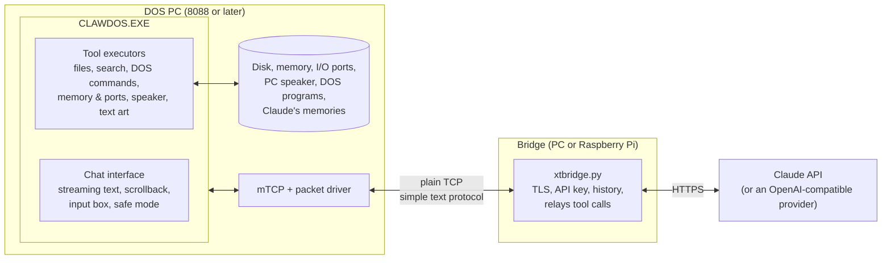

<h1 align="center">ClawDOS</h1>

<p align="center"><b>Claude, running on a 1983 IBM PC XT.</b><br>
An 8088 at 4.77 MHz, 640 KB of RAM and a CGA display, chatting with a modern AI over WiFi.</p>

<p align="center"></p>

<p align="center"><sub>ClawDOS on an emulated IBM 5160 (86Box: 8088, CGA), talking to the bridge's offline mock backend.</sub></p>

ClawDOS is a chat client and a small DOS software foundation for a real IBM
PC XT. It looks and feels like [Claude Code](https://claude.com/claude-code):
a welcome panel, the conversation scrolling above an input box, a spinner
while Claude thinks. Claude can also look around the XT, read and write its
files, compile programs on it and play music on its PC speaker.

The XT only speaks plain TCP. A small Python **bridge** on a modern machine
handles TLS, the API key and the model, so the XT side stays tiny and fast
(see [How it works](#how-it-works)).

## Features

**Chat**

- Streaming replies with word wrap and up to 80 columns of CP437 text, drawn on
  the CGA without snow.
- Hardware scrolling by moving the CGA's start address: scrollback (PgUp/PgDn)
  stays smooth on an 8088.
- Claude Code-style interface: welcome panel, pinned input box, spinner, status
  footer. Type ahead while Claude replies and your message is queued.
- Input editing with history recall, Esc to stop a reply, F2 for a new chat.
- Survives a lost link: it reconnects and resumes the conversation.
- Sets the XT's clock from the bridge on connect.

**Claude can use the XT**

- Reads and edits files, lists directories, searches text, runs DOS commands,
  peeks and pokes memory and I/O ports.
- Plays GW-BASIC `PLAY` tunes on the PC speaker and draws coloured CP437 text art.
- **Safe mode** is on by default: anything that changes files, memory or ports
  asks `Allow ...? (y/n)` first. F3 toggles it.
- **Memories**: Claude keeps its own notes on the XT's disk, and the list is put
  in front of it at the start of every conversation.

**Programs on the XT itself**

- The disk image carries assemblers (TINYASM, WASM, JWasm), Bruce's C, GW-BASIC
  and, if you supply your own floppy images, Turbo C 2.0. Claude is told about
  them and can write, compile and run programs on the machine.

**Any model**

- Anthropic's API by default; OpenRouter, Z.ai, OpenAI, Ollama, LM Studio and
  other OpenAI-compatible providers work too, and `/model` switches mid-chat.
- An offline `--mock` backend lets you try everything without an API key.

**Built to be tinkered with**

- A FreeDOS 1.4 boot image built from scratch by one command (`scripts/build.py`).
- Reusable DOS libraries in `lib/` (CGA screen, text console, bridge client on
  mTCP). 8086 instructions only, so it runs on a real 8088.
- Tested headless in DOSBox-X and on an accurate XT in 86Box.

## How it works

ClawDOS is a DOS program, not an XT program: it targets the 8086 instruction
set and talks to the network through a standard packet driver, so in principle
it runs on any PC-compatible running DOS with a network card and a CGA-compatible
text display. The 4.77 MHz IBM PC XT is simply the slowest machine it has to
be good on.

The real work happens on the DOS machine. **CLAWDOS.EXE** is the whole client
experience: the Claude Code-style interface, snow-free drawing and hardware
scrolling, input editing, safe mode, reconnecting after a lost link, and every
tool Claude uses. When Claude reads a file, edits a batch file, runs a
compiler, pokes a port or plays a tune, CLAWDOS.EXE does it on the DOS machine
itself, and Claude's memories live on its disk.

The **bridge** is the shim between the old world and the new. A 1980s CPU
can't do modern TLS, so the bridge holds the API key, speaks HTTPS to the
model, keeps the conversation history and relays tool calls to DOS and the
results back. It knows the tools' descriptions so it can offer them to the
model, but it never runs them.



On the XT the network card is a PicoMEM (an emulated NE2000 that talks WiFi);
in an emulator it's an emulated NE1000/NE2000 with NAT networking. The wire
format is in [docs/PROTOCOL.md](docs/PROTOCOL.md).

## What you need

| | |
|---|---|
| **To try it** | A Windows PC with Python 3. Everything runs in an emulator. |
| **For real hardware** | An IBM PC/XT (or compatible) with CGA and a PicoMEM card: it provides the disk (an image on a microSD card) and WiFi (NE2000). |
| **For the AI** | An API key (Anthropic by default), or run the bridge with `--mock` or against a local Ollama. |

## Run it locally (emulator)

1. **Fetch the tools** (once): `.\scripts\setup-tools.ps1`. This downloads Open
   Watcom, NASM, DOSBox-X, FreeDOS, mTCP and more into `tools/`, and installs
   86Box with winget.
2. **Build** the disk image: `python scripts/build.py` → `build\CLAWDOS.IMG`.
3. **Start the bridge** in one terminal:
   ```
   pip install -r bridge/requirements.txt
   python bridge/xtbridge.py --mock
   ```
   `--mock` answers like Claude would, offline. For the real thing set
   `ANTHROPIC_API_KEY` (in the environment, or in a `.env` file in the repo
   root, or run `ant auth login`) and drop `--mock`.
4. **Boot an emulated XT** in another: `python scripts/run86box.py` (8088,
   640K, CGA, with an NE1000 card and NAT networking). It boots, brings up the
   network and shows the `C:\>` prompt.
5. **Type `CLAWDOS`** (the old name, `CLAUDE`, still works). In the emulator the
   bridge is the host machine, `10.0.2.2:8023`, which the image is built to use.

Prefer DOSBox-X? `python scripts/rundosbox.py` boots the same image with
networking. It is faster but less exact (it emulates an 80186).

## Run it on a real XT

1. **Build the image** with the address of the PC that will run the bridge:
   ```
   python scripts/build.py --bridge 172.16.0.100:8023
   ```
   The address is remembered. On the XT it lives in `C:\NET\MTCP.CFG` as
   `CLAWDOS_BRIDGE`.
2. **Run the bridge** on that PC (or a Raspberry Pi) as above, without `--mock`
   for the real thing. The XT connects in on TCP port 8023, so allow it
   through the firewall (admin PowerShell):
   ```
   New-NetFirewallRule -DisplayName XTBridge -Direction Inbound -Protocol TCP -LocalPort 8023 -Action Allow
   ```
3. **Copy `CLAWDOS.IMG`** into the `HDD` folder on the PicoMEM's microSD card.
4. **Configure the PicoMEM**: in its BIOS menu pick the image as HDD0 (Disk) and
   make sure NE2000 is enabled (Other). The card's WiFi settings are its own;
   see the PicoMEM documentation.
5. **Boot the XT.** Networking comes up automatically (type `NETUP` to retry),
   then type `CLAWDOS`.

### Using it

Enter sends. Esc stops a reply or clears the input. Arrows, Home, End and Del
edit; Up/Down recall earlier messages; PgUp/PgDn scroll back; F1 help, F2 new
chat, F3 safe mode, F10 quit. `CLAWDOS host:port` overrides the bridge address;
`-m text` sends a message at startup and `-i text` pre-fills the input box.
Type `/model` to list model providers and switch.

## Reference

### Tools on the XT

The bridge offers the model a fixed set of tools; CLAWDOS.EXE runs them and
shows each call in the transcript (`● Read(C:\AUTOEXEC.BAT)` / `└ 24 lines`):

| Tool | What it does |
|---|---|
| `sysinfo`, `dir`, `read`, `peek` | Look at the system, directories, files (text or hex) and memory |
| `search` | Find text in files, with line numbers (much faster than running FIND) |
| `write`, `edit`, `delete`, `mkdir`, `rename` | Change files; `edit` replaces an exact piece of a text file instead of rewriting it |
| `run` | Run DOS commands on a plain DOS screen and read back what they printed: one per line, stopping at the first that fails (FreeCOM has no `&&`) |
| `poke`, `port` | Write memory, read or write I/O ports |
| `play` | Play a GW-BASIC `PLAY` tune on the PC speaker |
| `textart` | Print coloured CP437 text art into the chat |
| `memory_list`, `memory_read`, `memory_write` | Claude's own notes across conversations, in `C:\MEMORY\NAME.TXT` |

**Safe mode** (on at startup, F3 toggles it, shown in the bottom row): tools
that change files, memory or ports ask `Allow ...? (y/n)` first; looking,
playing music and memories never ask. `-unsafe` starts with it off, and `-q`
quits once the `-m` message is answered (both for unattended tests). Esc
during a tool stops the reply. Programs started by `run` can't use the network
or be stopped with Ctrl-C. They get about 290K of memory: `run` starts a plain program directly, and only loads a second COMMAND.COM (about 70K) for batch files, redirection and built-in commands.

With the mock bridge, `!tool NAME key=value ...` calls any tool (e.g.
`!tool read path=C:\AUTOEXEC.BAT`), `!play` is a demo, and
`!tooltour` exercises every tool.

### Programming on the XT

The image carries development tools that were tested on an 8088 at 4.77 MHz
(`python scripts/xttest.py image/tests/devtools.bat` re-runs that test in 86Box):

| Tool | What | Hello world |
|---|---|---|
| `TINYASM` | NASM-syntax assembler, makes .COM files (BSD) | ~5 s |
| `WASM` | Wolfware assembler, MASM-like (MIT) | ~5 s |
| `JWASMR` | JWasm, full MASM syntax, .COM or .EXE (Open Watcom licence) | ~18 s |
| `TCC` | Turbo C 2.0, from your own disks (see below) | ~27 s |
| `BCC` | Bruce's C, K&R C to .COM (GPL); lowercase file names only | ~80 s |
| `GWBASIC` | GW-BASIC built from Microsoft's MIT-licensed source | ~6 s |
| `LDEBUG` | lDebug, a scriptable FreeDOS DEBUG (Fair License) | |

They live in `C:\DEVEL` (licences in `C:\DEVEL\DOC`) and `C:\TC`, and
`C:\MEMORY\DEVTOOLS.TXT`, Claude's first memory, tells it how to use them.
Examples are in `C:\TESTS\DEV`. Turbo C is commercial: the build copies it from
your own floppy images in `external/` (e.g. `Borland - Turbo C v2.0 - Disk 3 of
6 - Command Line and Utilities.img`) and leaves it out if they aren't there.
Pacific C was tried and hangs on an 8088. `docs/research/` has the survey of
what else runs on an XT and what a licensed copy would add.

### Memories

Claude keeps notes on the XT itself, in `C:\MEMORY\NAME.TXT` (first line: a
one-line summary; at most 4000 bytes each). At the start of every conversation
the bridge runs `memory_list` on the XT (you'll see a `Memories` line) and puts
the list into the system prompt, so Claude knows what it saved before and reads
a memory in full when it's relevant. The memory tools never ask in safe mode.
Delete a memory with `DEL C:\MEMORY\NAME.TXT`, or ask Claude to (that uses
`delete`, which does ask). The mock and replay backends don't list memories.

### Other models

The bridge isn't tied to Claude. Besides Anthropic's API it speaks the
OpenAI-compatible chat API that OpenRouter, Z.ai, OpenAI, Ollama, LM Studio and
most others offer, so nothing changes on the XT. Built-in providers:
`anthropic` (default), `openrouter`, `zai`, `openai`, `ollama`, `mock`
(keys in `ANTHROPIC_API_KEY`, `OPENROUTER_API_KEY`, `ZAI_API_KEY`, `OPENAI_API_KEY`).
`--provider NAME --model MODEL` picks where new chats start. On the XT, type
`/model` to list providers and `/model openrouter:z-ai/glm-4.6` (or
`/model zai`, or just `/model some-model` on the current provider) to switch
mid-conversation; the history carries over. To add or change providers, copy
`bridge/providers.example.toml` to `bridge/providers.toml` (format in
`bridge/providers.py`). API keys only ever come from environment variables.

### System prompts

The system prompt comes from a file: `bridge/prompts/NAME.txt`, chosen with
`--prompt NAME` (default: `default.txt`). The bridge appends its add-ons after
it: how the XT's tools work, and the index of the XT's memories. Since
the file is the whole prompt, it must tell the model about the screen (plain
text, 80 columns, no Markdown): copy `default.txt` to start a new one. `{name}`
becomes the assistant's name. Files are re-read at the start of every
conversation, so an edit applies from the next chat (F2 on the XT) without
restarting the bridge.

### Testing without an API key

`python bridge/xtbridge.py --mock` answers like Claude would: a pause, then
text streamed in small pieces, with conversation memory. Nothing leaves your
machine. Messages starting with `!` run test scenarios; send `!help` on the XT
for the list. Among them: `!scroll` (60 lines), `!wide` (over-long word and
line), `!cp437` (character set), `!slow` and `!stall` (try Esc), and `!error`,
`!refuse`, `!cutoff`, `!drop` (failure modes). `--speed 3` makes it faster.
`python bridge/test_bridge.py` runs the protocol tests against it.

### Logs

The bridge keeps two logs, both gitignored:

- `bridge/xtbridge.log`: a debug log with every protocol line (rotating; `--log FILE`).
- `bridge/logs/YYYY-MM-DD/*.jsonl`: one file per XT connection, one JSON event per
  line: what you asked, Claude's replies, tool calls and results, and each API
  call's model, stop reason and token usage (`--convlog DIR`, `-` for none). Load
  it with `jq`, pandas or a few lines of Python.

## Project layout

| Path | What |
|---|---|
| `src/clawdos/` | CLAWDOS.EXE |
| `src/alias/` | CLAUDE.COM, which starts CLAWDOS.EXE under its old name |
| `lib/` | Reusable DOS pieces: `screen` (snow-free CGA, hardware scrolling, pinned footer), `console` (word-wrapping text stream with margins), `xtbridge` (bridge protocol on mTCP), and the tool executors: `toolapi`, `dosfs`, `memory`, `sysinfo`, `shell`, `edit`, `search`, `ems`, `play` + `sound` (music) |
| `tests/unit/` | CXTUNIT.EXE: unit tests for the hardware-free parsers, run in DOSBox-X |
| `bridge/` | XTBridge server and a test client (`chat.py`) |
| `src/boot/` | MBR and FreeDOS boot sector |
| `image/` | What goes on the disk image (`manifest.txt`, CONFIG/AUTOEXEC, tests) |
| `scripts/` | Build, image tool (`fatimg.py`), boot test, 86Box helpers, clangd shims for the Watcom dialect (`clangd/`) |
| `docs/` | [Roadmap](docs/ROADMAP.md), [bridge protocol](docs/PROTOCOL.md), research and design notes |

## License

Programs linking mTCP (CLAWDOS.EXE, anything using `lib/xtbridge`) are GPLv3.
